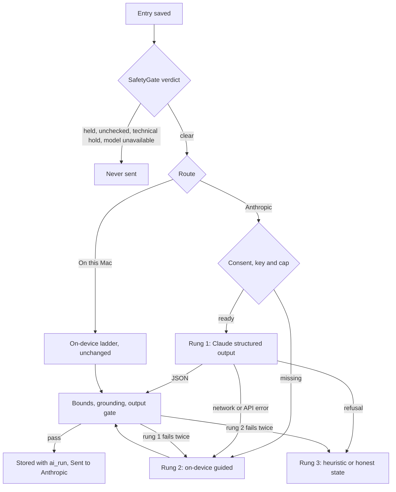

## 12. Bring your own model (BYOK)

Saro will let the founder send chosen AI features to his own Claude account through a separate Saro Lab build, while every default route stays on the Mac. The TestFlight alpha stays offline and carries no BYOK code. Whether the public app gets BYOK is decision D-19, due with the iPhone-or-canvas call on Fri 21 May 2027.

The alpha dates are unchanged: Alpha-0 on Fri 2 Apr 2027 and the alpha on Fri 16 Apr 2027. The alpha range is dev weeks 21-27, Fri 2 Apr to Fri 14 May 2027.

### 12.1 BYOK as an AI tier

BYOK is an optional tier beside Apple's on-device model, Private Cloud Compute and the heuristic twin. Each AI feature has a route in Settings > Models: On this Mac, Private Cloud Compute when entitled, or a provider the user added with their own API key. A fresh install routes everything to On this Mac, so nothing leaves the Mac until the user adds a key, consents and changes a route.

| Tier | Runs on | Default | Network | Status on Mon 26 Oct 2026 |
|---|---|---|---|---|
| Apple on-device | This Mac | Every route | None | Measured on the M5: AFM 3 Core Advanced, context 8,192 tokens |
| Apple Private Cloud Compute | Apple's servers | Named opt-in only | Through the system | Blocked: a test call failed with ModelManagerError 1046 (entitlement) |
| BYOK: Anthropic Claude | Anthropic's API, billed to the user's account | Off | Saro Lab only | Designed in this section |
| Heuristic twin | This Mac | Fallback on every route | None | Ported in P0-P2 |

### 12.2 How a Claude model plugs in

Claude plugs into Saro through the macOS 27 `LanguageModel` protocol, so Saro's `@Generable` types and session calls work unchanged. The SDK makes `LanguageModel` and `LanguageModelExecutor` public, and `LanguageModelSession` accepts `some LanguageModel` (FoundationModels.swiftinterface:1483, :1711, :1947-1956). Apple's `SystemLanguageModel` and `PrivateCloudComputeLanguageModel` conform to the same protocol (:295, :98).

An offline probe on the founder's M5 on 26 Oct 2026 tested the path with a stand-in Claude executor that returned canned JSON. The source and output are in the scratchpad folder `byokprobe/` (`main.swift`, `run1.txt`, `run2.txt`).

| Check | Result |
|---|---|
| Schema hand-off | `request.schema` reaches the executor; `JSONEncoder` turns it into JSON Schema with `$defs`, `$ref`, `required`, `enum`, `minimum`, `maximum`, `maxItems`, `title`, `x-order` and `additionalProperties: false` |
| Guided generation | Streamed `appendText` chunks decoded into the `@Generable` type |
| Options | Greedy sampling and `maximumResponseTokens` arrive; `includeSchemaInPrompt` is true on guided calls |
| Usage | `session.usage` shows the executor's input, cached and reasoning token counts |
| Refusal | A thrown `LanguageModelError.refusal` reaches the caller unchanged |
| Missing capability | A model without `.guidedGeneration` fails before the executor runs |
| Bounds | Not enforced: an out-of-list mood and quote index 99 decoded without error |
| Usage metadata | Extra keys sent with `updateUsage` don't reach `session.usage.metadata` |

Two results shape the design. Saro checks every bound itself after decoding: moods are a `@Generable` enum, indexes are checked against the candidate list, and arrays are capped in code. Cost fields that `session.usage` can't carry go to a Saro `CallRecorder` that the model hands to its executor.

Anthropic publishes an official Swift package for this protocol. ClaudeForFoundationModels (Apache 2.0, beta, release 0.2.3 on 7 Oct 2026) makes Claude a `LanguageModel`, but it is not a general Messages API client. Saro should still write its own small executor (D-22):

| Need | ClaudeForFoundationModels 0.2.3 | Saro-owned executor |
|---|---|---|
| API version | Client default `2023-06-01` | `2026-10-21` |
| Refusal | `stop_reason: refusal` ends the turn without an error | Throws `.refusal`; Saro never re-asks |
| Cost | Cache writes folded into the prompt total; reasoning tokens reported as 0 | Every usage field recorded and priced per model |
| What is sent | User-Agent carries the bundle ID, app version and OS version | Fixed User-Agent; every request body tested against an allowlist |
| Privacy promise | Adds a third-party package | No dependency |
| Cost to Saro | Ready now | About 300 lines plus tests, inside the 0.5 dev-week bench budget |

Saro needs no separate `AIBackend` protocol, because `LanguageModel` already is that abstraction. Apple on-device, PCC and Claude all sit behind it, so `actor SaroAI` only picks which model to pass.

```swift
struct ClaudeLanguageModel: LanguageModel {
    typealias Executor = ClaudeExecutor
    let modelID: String              // "claude-opus-5-5"
    let effort: String               // "low" or "medium"
    let recorder: CallRecorder       // tokens, cost, stop reason; never content
    var capabilities: LanguageModelCapabilities { .init([.guidedGeneration]) }
    var executorConfiguration: ClaudeExecutor.Configuration { .init(keychainAccount: "anthropic") }
}
// ClaudeExecutor.respond reads the key from the Keychain, POSTs to /v1/messages with stream true,
// sends each text_delta as .appendText, and throws LanguageModelError.refusal on stop_reason "refusal".
```

The configuration holds only the Keychain account name, never the key. The framework keys executors by configuration, and the probe saw one executor created per session.

### 12.3 What each touchpoint sends

A BYOK call gets exactly the inputs the on-device call would, never more because Claude's context is larger. Only entries in the clear state are sent, so safety-held, awaiting-a-check, technical-hold and model-unavailable entries never leave the Mac. No media file is ever sent.

| Touchpoint | What is sent | Default route | BYOK allowed? |
|---|---|---|---|
| Safety classifier (layer 2) | Nothing | On this Mac | No. The gate decides what may be sent, so it can't be routed out |
| Output gate (layer 3) and grounding | Nothing | Code on this Mac | No |
| Entry processing at save, and the backfill | Instructions, the schema, the entry's own text (body, user title, transcript of record) and up to 24 numbered candidate phrases | On-device ladder | Yes, in the Lab. The backfill asks first, shows an estimate and obeys the cap |
| Day reading | Per-entry annotations (title, summary, mood, mood basis) and numbered candidate quotes from the day's clear entries | On-device ladder | Yes, in the Lab. Never on a day with a safety hold or an entry awaiting a check |
| Reflect-deeper question | The turn's live text, once the gate clears it | On-device, raced 2.5 s against the heuristic | Yes, in the Lab. The race stays; a late call is cancelled |
| Reflect-further question | The written reflection | On-device ladder | Yes, in the Lab |
| Still captions | Nothing | On-device, default guardrails only | No. Images are never sent |
| Live captions and transcription | Nothing | On-device Speech | No. Audio is never sent |
| On-device canary | Nothing | On this Mac | No. It fingerprints Apple's model |
| Model bench | Synthetic eval cases only | Not a route | Yes, in the Lab |
| Weekly letter and What's changed (later) | Engine output: keys, counts and at most 12 short quotes, nothing from a safety-held day | Templates | Could, under the same rules as the PCC opt-in |
| Onboarding picks and first prompt (P8 model upgrade) | Onboarding answers after the gate | Deterministic ports | Could |
| Say it, and tone preview (P8) | Nothing | Local parser and rules | No |

Every request also leaves out entry ids, timestamps, time zones, the user's name and what they like to be called. It never includes observations from other days, word timings, EXIF or GPS. The tone label (one of 4) may be sent.

BYOK never stands in for the on-device classifier. On a Mac without Apple Intelligence, or in conservative mode, entries stay in the model-unavailable state and BYOK sends nothing.

### 12.4 The Claude request

Saro calls the Messages API directly with `URLSession`, one single-turn streamed request per model call. The entry-processing request looks like this:

```http
POST https://api.anthropic.com/v1/messages
x-api-key: (read from the Keychain for this request)
anthropic-version: 2026-10-21
anthropic-beta: server-side-fallback-2026-07-01
content-type: application/json

{
  "model": "claude-opus-5-5",
  "max_tokens": 8000,
  "stream": true,
  "fallbacks": "default",
  "system": [{"type": "text", "text": "(frozen Saro instructions for this prompt_version)",
              "cache_control": {"type": "ephemeral"}}],
  "messages": [{"role": "user", "content": "(task line, entry text, numbered candidates 0-23)"}],
  "output_config": {
    "effort": "low",
    "format": {"type": "json_schema", "schema": {"(sanitised EntryExtraction schema)": "..."}}
  }
}
```

| Foundation Models input | Messages API field |
|---|---|
| Transcript instructions | One `system` text block with a cache breakpoint |
| Prompt text segments | One `user` message |
| Prompt attachments | Refused with `unsupportedTranscriptContent`; media is never sent |
| Earlier responses, tool calls, reasoning | Refused; Saro sessions are single-turn |
| `request.schema` | `output_config.format` as `json_schema`, after the sanitiser |
| `includeSchemaInPrompt` | Ignored; the format field already carries the schema |
| `maximumResponseTokens` | `max_tokens`, default 8,000, because thinking counts toward it |
| `samplingMode`, `temperature` | Dropped: `temperature`, `top_p` and `top_k` return 400 on `2026-10-21` |
| `reasoningLevel` | Ignored; the route sets `output_config.effort` explicitly |
| Tool definitions | None; the model declares no `.toolCalling`, so the framework refuses tool requests |

| Model | ID | Input / output ($ per million tokens) | Cache read / 5-minute write ($ per million) | Thinking and API default effort | Refusal fallback |
|---|---|---|---|---|---|
| Claude Opus 5.5 (default) | `claude-opus-5-5` | 4 / 20 | 0.20 / 5 | Always on; `medium` | `fallbacks: "default"` |
| Claude Sonnet 5.5 | `claude-sonnet-5-5` | 2 / 10 | 0.20 / 2.50 (write derived as 1.25x) | Adaptive by default; `high` | `fallbacks: "default"`, Claude API only |
| Claude Haiku 5.5 | `claude-haiku-5-5` | 0.10 / 0.50 for prompts up to 100K tokens | 0.01 / 0.125 (both derived) | Adaptive by default; `medium` | None: send no `fallbacks` field |

Saro sends effort `low` for extraction and questions and `medium` for the day reading, and the bench tunes both. Saro omits the `thinking` field, so thinking text is never returned and never stored. Each request is single-turn, so the rules for replaying thinking blocks never apply.

The schema sanitiser keeps an allowlist of keywords and forces `additionalProperties: false` on every object. It drops `minimum`, `maximum`, `minItems`, `maxItems`, `pattern`, `title` and `x-order`, because structured outputs return 400 on numerical and array constraints. The first use of a schema compiles a grammar, which adds latency once, and Anthropic caches it for 24 hours.

### 12.5 Settings > Models and the provider registry

Settings > Models holds the providers, the routes, the spend and the key in one pane. The provider registry is a static list compiled into the Lab build, one row per provider. Routes, the cap and the enabled providers are plain preferences in `PrefsStore`; only keys are secret.

| Registry field | Anthropic row |
|---|---|
| Display and legal name | Anthropic (Anthropic, PBC) |
| Host | `api.anthropic.com`, HTTPS only |
| Models | Claude Opus 5.5, Claude Sonnet 5.5 and Claude Haiku 5.5, with the prices and fallback rules in 12.4 |
| Capabilities | Guided generation only |
| Consent text | Versioned; a new version asks again |

| Route (feature) | Choices | Default |
|---|---|---|
| Entry titles and summaries | On this Mac; Private Cloud Compute (greyed until entitled); Anthropic, with a model and effort | On this Mac |
| Day reading | Same | On this Mac |
| Questions while recording | Same | On this Mac |
| Questions on written reflections | Same | On this Mac |

The pane also shows today's and this month's spend, the daily cap, and the key as its last 4 characters with Test and Forget. Test looks up the chosen model in the Models API, which generates no tokens, and reports whether the key and the model work.

### 12.6 Keys

Keys live only in the macOS data protection keychain, readable on this Mac while it is unlocked, and never synced. The user types the key into a secure field in Settings > Models. Saro never reads a key from files, the clipboard or the environment.

| Keychain attribute | Value | Why |
|---|---|---|
| `kSecClass` | `kSecClassGenericPassword` | A plain secret |
| `kSecAttrService`, `kSecAttrAccount` | "Saro BYOK", the provider id ("anthropic") | One item per provider |
| `kSecUseDataProtectionKeychain` | true | On macOS, `kSecAttrAccessible` applies only with this set (SecItem.h:88-89, :1055) |
| `kSecAttrAccessible` | `kSecAttrAccessibleWhenUnlockedThisDeviceOnly` | Never migrates to another device (SecItem.h:588-613) |
| `kSecAttrSynchronizable` | false | No iCloud Keychain |

- The executor reads the key per request with `SecItemCopyMatching` and keeps it only for that request.
- The key never goes into UserDefaults, the container, logs, `ai_run`, exports, crash reports or the Alpha report.
- Forget deletes the item with `SecItemDelete` and sets every Anthropic route back to On this Mac. Erase everything does the same.
- A Developer ID build may need an embedded provisioning profile for the data protection keychain, so the Lab tests this on its first day.

```swift
let item: [String: Any] = [
    kSecClass as String: kSecClassGenericPassword,
    kSecAttrService as String: "Saro BYOK",
    kSecAttrAccount as String: "anthropic",
    kSecUseDataProtectionKeychain as String: true,
    kSecAttrSynchronizable as String: false,
    kSecAttrAccessible as String: kSecAttrAccessibleWhenUnlockedThisDeviceOnly,
    kSecValueData as String: Data(key.utf8),
]
let status = SecItemAdd(item as CFDictionary, nil)   // anything but errSecSuccess: show the error, store nothing
```

### 12.7 Consent

Nothing is sent to a provider until the user allows it on a screen that names the provider and exactly what is sent. App Store guideline 5.1.2(i) requires apps to disclose sharing personal data with third-party AI and to get explicit permission first. Saro applies the same rule in the Lab, per provider and per feature.

The screen appears the first time a route is set to a provider. It appears again when the routed features, the fields sent or the consent text version change. It shows:

- the provider's legal name and the model;
- each routed feature with the fields it sends, from 12.3;
- what is never sent: recordings, photos, word timings, held or unchecked entries, the user's name, dates and other days;
- the provider's data terms, linked: API inputs and outputs are deleted within 30 days by default, flagged requests are kept up to 2 years, and the Commercial Terms bar training on API content;
- that usage bills the user's own Anthropic account, and the daily cap;
- that every request appears in What Saro read, and how to stop.

Draft copy, for the founder and the clinician to review:

> **Send to Anthropic?** Saro Lab will send the features below to Anthropic's Claude, using your API key and your Anthropic account. It sends the words of entries Saro's safety check has cleared, short numbered phrases from them, and Saro's instructions. It never sends recordings, photos, entries Saro held for safety or hasn't checked, your name or dates. Anthropic deletes API data within 30 days unless its systems flag a request. Each request is listed in What Saro read. **[Not now] [Allow for these features]**

Allow writes a `provider_consent` row. Switching a route back to On this Mac stops new sends at once. Data already sent follows the provider's retention.

### 12.8 Safety and grounding around every call

Saro's own gate runs before every BYOK call, and every BYOK output passes the same grounding and output gate as on-device output. The order for one call:

1. Every input entry must have a clear verdict. The precedence holds: safety hold > model unavailable > technical hold > clear, and an entry awaiting a check is never sent.
2. The route, the consent row, the key and the daily cap must all be in place, or the call takes the on-device path.
3. The request builder copies only the fields allowed in 12.3.
4. Claude returns JSON under the sanitised schema.
5. Saro checks bounds, then runs grounding: verbatim quotes by index, the noun-and-entity drift check, banned phrases and history words.
6. The output gate runs the phrase gate over every generated string. A hit suppresses the output and makes the entry a safety hold, as on device.

A BYOK route replaces rung 1 of the ladder. The guard stays at most 4 model calls per touchpoint per entry, 2 per rung.

| Rung | On a BYOK route | Calls |
|---|---|---|
| 1 | Claude with structured output, plus one grounding retry in a fresh request | Up to 2 |
| 2 | On-device guided `@Generable` with default guardrails, only after a transport, account or cap failure on rung 1 | Up to 2 |
| 3 | The labelled heuristic twin or an honest state | 0 |

A refusal goes straight to rung 3, because Saro never re-asks any model after a refusal. A Claude refusal, like an Apple guardrail hit, is not a safety signal. It never shows the SafetyCard by itself.



### 12.9 Refusals, errors and offline

Every failure falls to the on-device path, so a missing network or key never blocks capture, saving or a reading.

| Signal | What the executor does | What the user sees |
|---|---|---|
| `stop_reason: "refusal"`, after any server-side fallback | Throws `LanguageModelError.refusal` with the category | The heuristic or an honest state; the same input is not sent to that provider again for that touchpoint and prompt_version |
| `stop_reason: "max_tokens"` | Throws a truncation error | One retry on rung 1 with `max_tokens` doubled, then rung 2 |
| JSON that fails decoding or bounds | Framework or Saro error | Counts as a grounding failure: one retry, then rung 2 |
| 400 invalid request | Error with the API message, logged content-free | Rung 2; the bench flags it as a Saro bug |
| 401 or 403 | Missing or rejected key | Rung 2; Settings shows "Key needs attention" until the key works |
| 404 | Model not found | Rung 2; Settings shows the model as unavailable |
| 413 | `.contextSizeExceeded` | Rung 2, no retry |
| 429, 529, 5xx, or an SSE `error` event | `.rateLimited` or an API error | Rung 2 |
| Offline, or no data for 20 s at save | `.timeout` or the transport error | Rung 2; Settings shows "Offline, using this Mac" |
| Daily cap reached | No request | Rung 2 until local midnight |

Server-side fallbacks retry only policy declines, never rate limits or server errors. On Opus 5.5 a `reasoning_extraction` decline is not retried. Haiku 5.5 has no server-side fallback, so its requests carry no `fallbacks` field.

The SSE reader handles `message_start`, `content_block_start`, `content_block_delta`, `content_block_stop`, `message_delta`, `message_stop`, `ping` and `error`. It ignores unknown event types, as Anthropic's versioning policy asks. Only `text_delta` text reaches the channel; thinking and signature deltas are dropped.

### 12.10 Cost, the daily cap and prompt caching

Every call's cost comes from its usage fields and the model's prices, and it shows in What Saro read and in Settings.

Cost = `input_tokens` × input price + `cache_creation_input_tokens` × write price + `cache_read_input_tokens` × read price + `output_tokens` × output price. Output tokens include thinking. A served fallback is priced from `usage.iterations`, each attempt at its own model's rates.

| Call on Opus 5.5 | Input tokens | Output tokens, with thinking | Planning cost |
|---|---|---|---|
| Entry processing, effort low | about 3,000 | about 1,500 | about $0.04 |
| Day reading, effort medium | about 2,500 | about 2,000 | about $0.05 |
| Follow-up question, effort low | about 1,000 | about 500 | about $0.015 |
| One founder day: 4 entries, 4 readings, 4 questions | - | - | about $0.40 |

These are planning estimates, and the bench measures the real numbers. Haiku 5.5 costs a fortieth of Opus 5.5 per token. Prices sit in a versioned table in the build, and the display says "estimate".

- The daily cap defaults to $2.00 per local day and is set in Settings > Models.
- Before each call, Saro checks that today's spend (the sum of `ai_run.cost_micros`) is under the cap.
- The cap can overshoot by one call: at most about $0.17 on Opus 5.5 at 8,000 output tokens.
- At the cap, routes fall back to on-device until midnight, and Settings says so.
- The founder also sets a spend limit on a dedicated Anthropic workspace, as a second fence.

The `system` block carries one cache breakpoint and stays byte-identical per `prompt_version`, with no dates, names or counts. Caching engages only when that prefix is at least 512 tokens on these models, and silently doesn't below that. A 5-minute write costs 1.25 times input and a read costs 0.05 times on Opus 5.5, so the backfill, the bench and day-reading reruns gain most.

### 12.11 What Saro read

Each BYOK call adds one content-free row to What Saro read, marked "Sent to Anthropic". A row reads: Sent to Anthropic · Day reading · 4 entries · Claude Opus 5.5 · 2,480 in, 1,910 out · $0.048 · 14:32.

- The row comes from `ai_run`, and `ai_run_input` lists which fields and UTF-16 windows were sent.
- Request and response bodies are never written to disk or to the log.
- `URLSession` runs with an ephemeral configuration, so no response lands in the disk cache.
- A refusal row shows the category, never the text. What Saro read is in Export, as today.

### 12.12 The Saro Lab build

Saro Lab is a separate Developer ID build for the founder's Mac, so the TestFlight alpha keeps its promise that Saro has no way online. Both builds come from one codebase. BYOK code lives in a module that only the Lab target links.

| Property | TestFlight alpha | Saro Lab |
|---|---|---|
| Bundle ID and container | Saro's | Its own, so it has its own journal |
| Signing and distribution | TestFlight, after Beta App Review | Developer ID, notarised, the founder's Mac only |
| Sandbox network entitlement | None, checked with `codesign -d --entitlements` in CI | `com.apple.security.network.client` |
| BYOK module | Not linked; CI fails a build whose binary contains `api.anthropic.com` | Linked |
| Hosts contacted | None | `api.anthropic.com` only; redirects to other hosts refused |
| Welcome line 1 | "Saro has no account, no server and no way online..." | "Saro Lab goes online only to reach AI providers you add, for the features you route to them." |
| Journal | The founder's real journal | Starts empty; the founder imports a `.saroexport` when he wants real entries |

Founder actions before the Lab work starts:

1. Create an Anthropic workspace named "Saro Lab", with one API key and a monthly spend limit.
2. Enter the key only in Saro Lab's Settings > Models, never in chat, files or notes.
3. Decide D-22 at the P0 review on Fri 20 Nov 2026. D-20 follows the bench readout on Fri 18 Dec 2026, and D-21 is due Fri 22 Jan 2027.

### 12.13 The model bench

The founder's first use of BYOK is a bench that runs the same synthetic eval cases on Apple on-device and on Claude, side by side. It reuses the Evaluations-based suite, the case files in `backend/evals/cases`, the safety corpus, the drift strings and the golden fixtures. No journal entry is ever a bench case, matching the rule that real text never enters evals.

| Measure | Apple on-device | Claude, per model and effort |
|---|---|---|
| Parse and decode rate | Per rung | Rung 1 |
| Grounding pass rate | Quote indexes, drift check, banned phrases, history words | Same |
| Output-gate hits | Count and rate | Same |
| Refusals and guardrail hits | Guardrail hits per rung | Refusals by category, and fallbacks served |
| Safety routing | Classifier recall on 100+ risk cases; SafetyCard rate on 100+ venting cases | The same labels asked of Claude, in the bench only; the product classifier stays on device |
| Latency | First token and total, cold and warm | Same, plus the first-use schema compile |
| Tokens and cost | Tokens | Tokens and dollars |

- Reports are keyed by `os_build`, variant, model fingerprint, `prompt_version`, provider, model and effort, and saved to a folder the founder picks.
- A run first shows its cost estimate and needs a click: about $8 for a full run on Opus 5.5, $4 on Sonnet 5.5 and under $0.25 on Haiku 5.5.
- Claude has no greedy mode on `2026-10-21`, so 20 cases run 3 times each to measure variance.
- Both backends get identical instructions and inputs, so the comparison is fair.
- The bench also lays out 20 outputs side by side for the founder to read.

### 12.14 Later providers

Each later provider is one more `LanguageModel` conformance, plus a registry row, a consent text, a price table and a schema mapping. The gate, the ladder, the call guard, the cap, logging and the bench don't change.

| Provider | Conformance | Structured output | Key | Network | Size |
|---|---|---|---|---|---|
| OpenAI-compatible endpoint | `OpenAICompatibleModel`, with a base URL and model id | Its JSON-schema response format, with its own sanitiser | Keychain, one item per host | Lab entitlement; the host joins the allowlist and the consent screen | S, 0.5 dev-week |
| Google Gemini | `GeminiModel` | Its response schema, with its own sanitiser | Keychain | Same | M, 0.75 dev-week |
| Local MLX or Core AI model | A maintained `LanguageModel` package (WWDC26 session 339 names both) | Package-defined | None | None, so it could run in the offline build | S, 0.5 dev-week with a maintained package |

A local model needs no consent screen, because nothing leaves the Mac. It still gets the same gate, grounding and bench. Its weights must arrive without the network entitlement, for example by import from a file.

### 12.15 Data model changes

| ID | Change | Rule |
|---|---|---|
| DR-25 | `ai_run` gains `provider`, `model_requested`, `model_served`, `effort`, `message_id`, `http_status`, `stop_reason`, `refusal_category`, `cache_write_tokens`, `cache_read_tokens`, `cost_micros` and `fallback_used`; `executor` gains the value `byok` | Content-free and append-only, as today |
| DR-26 | New `provider_consent(id, provider_id, consent_version, features JSON, fields_version, event, at)`, where event is granted or revoked | Append-only |
| DR-21 (section 14) | Routes, the daily cap and the enabled providers live in `PrefsStore` (UserDefaults) | No secrets |
| DR-27 | Export carries `provider_consent` and the BYOK `ai_run` rows; Erase everything also deletes the Keychain items | Keys are never exported |

### 12.16 Requirements

Lab requirements are Should: they are not alpha scope, and they ship before App Store 1.0. Public BYOK is Could until D-19 decides it.

| ID | Requirement | Priority | Acceptance |
|---|---|---|---|
| FR-BYOK-01 | The TestFlight alpha and the App Store build link no BYOK module and carry no network entitlement. | Must | Xcode Cloud fails any alpha build whose entitlements list `com.apple.security.network.client` or whose binary contains `api.anthropic.com`. |
| FR-BYOK-02 | Saro Lab is a separate, notarised Developer ID build with its own bundle ID and container and the network entitlement, installed only on the founder's Mac. | Should | The Lab opens on the M5; its container path differs from the alpha's; the alpha journal is unchanged after a Lab session. |
| FR-BYOK-03 | Settings > Models lists the providers and one route for each of the 4 routable features, and every route defaults to On this Mac. | Should | On a fresh Lab install the network log shows no request until a key, a consent and a non-default route exist. |
| FR-BYOK-04 | The user enters a key in a secure field; Saro stores it only in the data protection keychain, this device only and not synchronisable, and tests it with a Models API lookup. | Should | A canary key string is absent from UserDefaults, the container, logs, exports and crash reports after a bench run; Test reports key and model status. |
| FR-BYOK-05 | Forget key deletes the Keychain item and resets that provider's routes to On this Mac; Erase everything also deletes it. | Should | After Forget, `SecItemCopyMatching` returns `errSecItemNotFound` and every route reads On this Mac. |
| FR-BYOK-06 | A consent screen names the provider, model, features, fields sent, fields never sent, the data terms and billing, before the first send and whenever any of these change. | Should | No request before Allow; Allow writes a `provider_consent` row; routing a new feature asks again. |
| FR-BYOK-07 | Only clear entries are sent, and no day reading is sent for a day with a safety hold or an entry awaiting a check. | Should | Across the safety corpus: 0 requests for safety-held, awaiting-a-check, technical-hold, no-verdict and model-unavailable entries. |
| FR-BYOK-08 | Requests carry only the fields in 12.3: never media, word timings, EXIF, GPS, entry ids, timestamps, names or other days. | Should | A golden request-body test per touchpoint matches an allowlist of JSON keys and source fields. |
| FR-BYOK-09 | Every BYOK output passes bounds checks, grounding and the output gate before it is stored. | Should | Injected outputs with an unknown mood, index 99 or an invented noun are rejected; the bench stores 0 ungrounded outputs. |
| FR-BYOK-10 | Claude requests use `POST /v1/messages`, `anthropic-version: 2026-10-21`, `stream: true`, the sanitised schema in `output_config.format`, an explicit effort, no sampling parameters and no `thinking` field. | Should | Request-builder tests pass; a full bench run returns no 400. |
| FR-BYOK-11 | `stop_reason: "refusal"` ends the call as a refusal; Opus 5.5 and Sonnet 5.5 requests send `fallbacks: "default"` with beta `server-side-fallback-2026-07-01`; Haiku 5.5 requests send no `fallbacks`. | Should | A recorded refusal stream leads to the heuristic, no second request, and an `ai_run` row with status refusal and its category. |
| FR-BYOK-12 | After a refusal Saro never re-asks any model, and the same input is not sent again to that provider for that touchpoint and prompt_version. | Should | A second attempt on a refused input hash makes no request. |
| FR-BYOK-13 | Transport, account, rate-limit, server, timeout, offline and cap failures fall to the on-device guided rung, then the heuristic, with at most 4 model calls per touchpoint per entry and 2 per rung. | Should | Fault-injection tests cover every row of 12.9; the call counter never passes 4. |
| FR-BYOK-14 | Each call records input, cache-write, cache-read and output tokens, the model served and its cost; Settings shows today's and this month's spend. | Should | Fixture costs match the rate table to the micro-dollar, including a fallback iteration. |
| FR-BYOK-15 | A daily spend cap, default $2.00 per local day, stops new BYOK calls once reached, until midnight. | Should | With a $0.05 cap, the first call after the cap is crossed makes no request; overshoot is at most one call. |
| FR-BYOK-16 | The frozen instructions carry one prompt-cache breakpoint and stay byte-identical per prompt_version. | Should | Repeat bench runs show `cache_read_input_tokens` above 0 whenever the system block is at least 512 tokens. |
| FR-BYOK-17 | Each BYOK call adds a content-free What Saro read row: "Sent to Anthropic", feature, entry count, model, tokens, cost and time. | Should | Rows hold no entry text and appear in Export. |
| FR-BYOK-18 | The Lab contacts only `api.anthropic.com` over HTTPS through an ephemeral `URLSession`, and refuses redirects to other hosts. | Should | The network log lists one host; a redirect test fails closed; Caches holds no response data. |
| FR-BYOK-19 | The model bench runs the same synthetic cases on Apple on-device and on each configured Claude model, reports the measures in 12.13 and previews its cost first. | Should | One run writes a side-by-side report keyed as in 12.13, using no journal text. |
| FR-BYOK-20 | If D-19 says yes, the App Store build offers the same routes, with the welcome and Settings copy and the App Privacy answers changed in the same release. | Could | App Review accepts the build; the copy matches the network log. |
| FR-BYOK-21 | Further providers (OpenAI-compatible, Google Gemini, local MLX or Core AI) plug in as `LanguageModel` conformances with a registry row, consent text, price table and schema mapping. | Could | Each provider passes the bench and the request-body tests. |
| FR-BYOK-22 | BYOK routes for the safety classifier, still captions, transcription, live captions and the canary, and any sending of media. | Won't | Settings > Models shows no route for them. |
| FR-BYOK-23 | A Saro-supplied shared key or a Saro-run proxy. | Won't | No Saro-operated endpoint exists; every key is the user's own. |

Non-functional, security and data requirements:

- NFR-35 (Should): No BYOK failure blocks capture, saving or the on-device path, and at-save BYOK work starts only after the entry row commits.
- NFR-36 (Should): At-save calls give up after 20 s without data; reflect-deeper keeps its 2.5 s race and cancels a late call.
- NFR-37 (Should): The Claude executor depends only on Foundation, Security and FoundationModels (D-22).
- NFR-38 (Should): Settings > Models and the consent screen pass the accessibility audit used for the rest of the app.
- NFR-39 (Should): The spend Settings shows matches the `ai_run` sum within 1 cent.
- Safety and security: SR-36 to SR-43 in section 13 govern every BYOK call. One addition, SR-44 (Should): the SafetyGate verdict of every input entry is checked again just before the request is built.
- DR-25 to DR-27 (Should): as in 12.15.

### 12.17 Effort and schedule

The Lab bench costs 0.5 dev-week, Lab routes 1.0 and a public BYOK about 2.5 more. Every BYOK week comes out of the one developer's time, so each one moves a date unless it uses buffer.

| Work | Size | Dev-weeks | Contents | When |
|---|---|---|---|---|
| Lab bench | S | 0.5 | Claude executor and sanitiser (0.25), Keychain key field (0.05), bench runner and report over the existing eval loaders (0.15), Lab scheme, signing and notarisation (0.05) | Prototype in the overnight build if approved (synthetic cases only); hardened in P1 from its buffer (1.0 to 0.5), ready Fri 11 Dec 2026; readout Fri 18 Dec 2026 settles D-20 |
| Lab routes | M | 1.0 | Routes and registry (0.2), consent screen and rows (0.15), ladder integration and call guard (0.15), cost, cap and spend (0.15), What Saro read rows (0.05), request-body and fault-injection tests (0.2), host allowlist and Lab copy (0.1) | Set by D-21 (due Fri 22 Jan 2027); default after the iPhone-or-canvas call on Fri 21 May 2027 |
| Public BYOK, Anthropic only | L | 2.5 | App Store build with the entitlement and reworked CI checks (0.25), privacy copy, App Privacy answers and review notes (0.5), consent and key UX for non-technical users (0.5), error and offline UX (0.5), release-grade minimisation and consent tests (0.5), App Review buffer (0.25) | Only if D-19 says yes, in the track that ships App Store 1.0 |
| Each later provider | S or M | 0.5-0.75 | See 12.14 | After App Store 1.0 |

If D-21 puts Lab routes at the start of P5 instead, engine v0 moves to Fri 14 May 2027 and the iPhone-or-canvas call to Fri 28 May 2027, and D-19 moves with the call.

### 12.18 Decisions

| ID | Decision | Options | Recommendation | Decide by |
|---|---|---|---|---|
| D-19 | Whether the public app carries BYOK | (a) No: App Store 1.0 stays offline and the Lab stays founder-only; (b) yes, as an opt-in in the App Store build, with the welcome copy changed; (c) a separate public Saro Lab product | (a), unless the bench shows Claude day readings passing the 90% narrative gate while on-device fails it, and PCC is still unavailable; then (b) | Fri 21 May 2027, with the iPhone-or-canvas call |
| D-20 | Default Claude model for BYOK routes | `claude-opus-5-5`; `claude-sonnet-5-5`; `claude-haiku-5-5`; each route can still pick its own | `claude-opus-5-5` (Claude Opus 5.5, $4 / $20 per million input / output tokens), confirmed by the bench | Fri 18 Dec 2026 (bench readout) |
| D-21 | When Saro Lab gets BYOK routes (Lab-2, 1.0 dev-week) | After the iPhone-or-canvas call; at the start of P5 (later dates move about 1 week); never, bench only | After the Fri 21 May 2027 call: the bench answers the quality question first | Fri 22 Jan 2027 (end of P1) |
| D-22 | Who owns the Claude executor | (a) Saro, on `URLSession`; (b) Anthropic's ClaudeForFoundationModels package; (c) the package for the synthetic bench, then Saro's executor before any journal text is sent | (a): the current API version, explicit refusals, exact cost, an auditable request body and no dependency, inside the bench budget | Fri 20 Nov 2026 (P0 review) |

### 12.19 Risks

R-20, R-21, R-28 and R-30 also sit in the risk register (section 17); R-31 to R-35 are build risks specific to BYOK.

| ID | Risk | Severity | Mitigation |
|---|---|---|---|
| R-20 | The network entitlement or BYOK code reaches the offline TestFlight build and breaks "no way online". | Medium | BYOK lives in a Lab-only module; CI fails on the entitlement or the host string; the P3 network-log audit stays. |
| R-21 | Cleared journal text is still sensitive (abuse, intimacy, drinking), and Anthropic keeps API data up to 30 days, or 2 years if flagged. | Medium | Founder-only Lab; consent names the terms; minimised inputs; never held or unchecked entries; a dedicated workspace. |
| R-28 | Spend runs away through reruns, the backfill or a loop. | Low | Daily cap, the 4-call guard, a backfill estimate and confirmation, and a workspace spend limit. |
| R-31 | Beta surfaces drift: the OS 27 server-model API and Anthropic's beta headers. | Medium | Recorded SSE fixtures in tests; a bench re-run on each Xcode and macOS update; fallbacks are optional, so a header change only loses the fallback. |
| R-32 | Structured outputs reject a schema with a 400 because `GenerationSchema` emits keywords Anthropic doesn't support. | Medium | The allowlist sanitiser; a test runs every Saro schema through it; bounds checked in code. |
| R-33 | The data protection keychain fails under Developer ID signing without a provisioning profile. | Low | Test on the first Lab day; embed a Developer ID provisioning profile; never fall back to UserDefaults. |
| R-30 | App Review rejects or delays BYOK in a mental-health-adjacent journal. | Low | Lab first; consent built to guideline 5.1.2(i); an App Review inquiry before D-19. |
| R-34 | Bench comparisons mislead: Claude has no greedy mode on `2026-10-21`, and synthetic cases differ from real entries. | Low | 3-run repeats on 20 cases, variance reported, and 20 outputs read side by side. |
| R-35 | Claude's own safety behaviour on venting text (declines, crisis wording) shows in readings. | Low | The output gate on all output; refusals go straight to the heuristic, never to another model; the bench measures refusals on the venting corpus. |

### 12.20 Open questions

- Do structured outputs accept `title` and `x-order`, or return 400? The sanitiser drops them either way.
- Is each touchpoint's frozen system block at least 512 tokens, the minimum for prompt caching?
- Does the data protection keychain work in a Developer ID build without an embedded provisioning profile?
- What first-token and total latency do Opus 5.5 and Haiku 5.5 give for a follow-up question at effort low?
- How many input tokens does the schema in `output_config.format` add for `EntryExtraction`?
- Are Sonnet 5.5 and Haiku 5.5 cache prices 1.25x and 0.1x of input, as derived here?
- Do Anthropic's terms allow an app to accept end users' own API keys, for a public BYOK?
- Which App Privacy answers would a public BYOK build need?
- Is a cancelled reflect-deeper stream billed for its full output so far?
